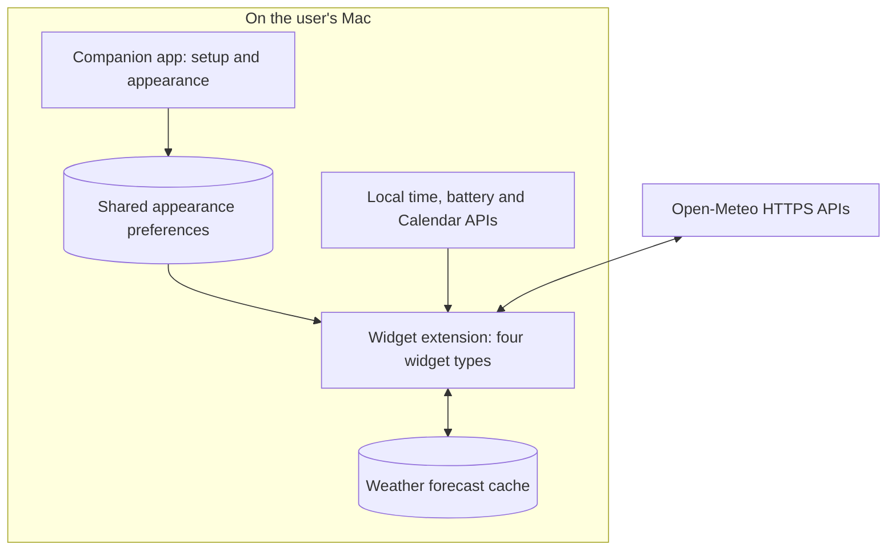

# Desktop Widgets — living project context

> Paste this document into the restored project chat. Ask that agent to save it at an appropriate documentation path, preserve its evidence baseline, and use it for future `$project-catchup` conversations. This is learning context, not authorization to change code, publish, enroll in services, or schedule work.

## Start here

**Purpose:** A personal native macOS app the user worked on to help his girlfriend customize her desktop with Time & Date, Weather, Battery, and Calendar widgets.

**Current learning position:** The user reports understanding the architecture and engineering concepts below. Terminology may need quick refreshers. Specific personal implementation responsibilities and original detailed requirements remain unconfirmed.

**Presentation preference:** Visual first. Start with one sentence, a 4–7-node diagram or compact table, and at most three takeaways. Explain one topic at a time, normally under 200 words for a follow-up. Offer depth rather than dumping a complete report. Use concrete project examples; no unsolicited quizzes. A saved reference can be longer than its chat summary.

## Project at a glance



| Technology | Job |
|---|---|
| Swift 6 language mode; macOS 14 minimum | Project build settings, not a claim about every user's installed runtime |
| SwiftUI / AppKit | UI and selected macOS integrations |
| WidgetKit | Widget registration, presentation and timeline lifecycle |
| App Intents | Per-widget configuration, searchable city entities, Calendar actions |
| Foundation / URLSession / Codable | Dates, networking and data serialization |
| Swift concurrency actor | Coordination of identical in-flight weather requests |
| EventKit / IOKit | Local Calendar access / internal battery readings |
| App Groups / UserDefaults | Shared applied appearance; extension preferences |
| Local JSON / CryptoKit hashes | Forecast cache and hashed filenames; hashing is not encryption |
| Bash / launchd / signing tools | Personal installation and optional signing maintenance |
| XCTest / ImageRenderer / GitHub Actions | Behavior, rendering smoke tests, coverage and Release builds |

The inspected project has no external Swift package declarations or hosted application backend. Weather is its remote application-data integration. Version 1.0 is documented as a source-first personal release.

## How the widgets work

```text
macOS passes widget configuration to provider
    → provider reads local data or fetches weather
    → returns dated entries + a reload policy
    → SwiftUI describes each entry's appearance
    → macOS presents entries and later requests another timeline
```

- A timeline is a prepared schedule, not a continuously replenished queue. Entries do not each trigger a new network request.
- The extension runs separately from the companion app. Ordinary in-memory app variables are not shared across that boundary.
- Entry dates and provider reload requests are separate. macOS owns actual execution and may delay/coalesce reloads.

| Widget | Entries prepared | Requested next reload |
|---|---|---|
| Clock | 60 minute-aligned entries | `.atEnd`, after the last entry; roughly hourly |
| Battery | One current reading | After 5 minutes |
| Weather, loaded or stale | Seven hourly entries using one forecast snapshot | After 1 hour |
| Weather, retryable failure without usable cache | One error entry | After 30 minutes |
| Weather, nonretryable failure | One error entry | `.never` for scheduled reloads; configuration changes can trigger new work |
| Calendar, event features off | One entry | Next local midnight |
| Calendar, event features on | One entry | Earliest of 30 minutes, midnight, and a known next-event boundary when next-event timing is enabled |

The intervals are implemented choices. No measurements establish them as experimentally optimal.

## Customization and cohesion

| Layer | User choices | Scope |
|---|---|---|
| macOS widget editor / App Intents | City, units, layout, formatting, details | Each placed widget |
| Companion app Appearance | Global typography, font coverage, theme overrides | Global, with overrides by widget type |

```text
Preview draft → Apply → save App Group preferences → one reloadAllTimelines request
```

- Themes: System, Modern, Editorial, Technical, Playful, Handmade.
- Display Text themes prominent values; All Text also themes supporting labels.
- Shared surfaces, spacing, status treatments, accessibility labels and font-aware layout adjustments produce cohesion.
- Small widgets simplify information; Medium/Large expand it.
- Time & Date can preserve per-copy date/time fonts. Calendar month navigation is shared across Calendar copies, despite independent configuration options.
- Preview does not persist until Apply; Revert restores the applied selection. Widgets may transition at slightly different times.
- macOS controls placement and system background treatments. This is a curated appearance system, not arbitrary theme/CSS editing.

## Weather flow and reliability

```text
City selection → resolved location + units → WeatherLoader
    → matching cache fresh within 15 minutes? Return it
    → otherwise request forecast → decode → save → timeline
    → on request failure, use valid cache up to 24 hours old as stale
    → without usable cache, show error
```

Cache identity includes geographic and presentation identity plus units. Retention is capped at 12 forecast files; this is not a strict byte limit. Identical simultaneous requests share one actor-coordinated task; completed tasks are removed. There is no persistent decoded in-memory cache. The service currently requests 30 hourly forecasts; an older guide paragraph says 24, so prefer source for that detail.

Calendar access is optional and explicit. Events are reduced to counts and timing before reaching widget models; titles, notes, locations and attendees are excluded. Weather sends selected city searches/coordinates, not GPS tracking data.

## Concepts already discussed

| Term | Project example |
|---|---|
| Separation of concerns | Provider, model, presentation and view responsibilities |
| Dependency injection | `WeatherLoader` receives a service and cache; a fake service can simulate failure |
| Protocol | Common contract allowing real and fake weather services to be substituted |
| Request coalescing | Matching concurrent forecasts share one operation |
| Bounded caching / graceful degradation | Limited saved forecasts; stale labeled fallback |
| Data minimization | Calendar timing/counts rather than event text |
| Design system / compatibility | Shared appearance rules; stable identifiers/defaults |
| Explicit state modeling | Distinguish failed reads from absent hardware |

Dependency injection is broader than changing a URL: it substitutes behavior. Hard-coded constants are not inherently wrong; vary the things that need substitution.

## Performance: hypotheses, not measured findings

| Approach | Benefit | Cost |
|---|---|---|
| Temporary decoded memory cache / longer predictable timelines | Less repeated work | More memory/upfront preparation; extension can terminate |
| Fewer saved files / compression | Less disk | More misses or CPU work; benefit may be negligible |
| Current bounded reuse + coalescing | Balance | Must measure actual workload before further changes |

Suggested experiment: instrument cache read, HTTP transfer, response decode, cache save and timeline construction using signposts. Compare uncached, fresh-cache and stale-cache/network-failure cases. Use Time Profiler, Allocations, HTTP Traffic and cache byte counts. Profile the extension, not just the companion app; a controlled harness can exercise the same loader. Provider duration excludes macOS scheduling and final display latency. Earlier numerical examples were invented, not observations. No instrumentation or optimization was implemented.

## Distribution discussion: future option

| Route | Role | Limitation |
|---|---|---|
| Existing Personal Team setup | Build/sign on recipient's Mac; optional daily launchd maintenance | Requires Xcode/account setup; renewal can require attention |
| TestFlight | Link-based installation and beta updates | Each build expires after 90 days; external beta review applies |
| App Store | Released app with store updates | App Review and release preparation |
| Developer ID + notarization | Direct Mac download | Arrange hosting and update delivery |

As checked November 2, 2026, one Apple Developer Program membership (US$99/year, local pricing where available) covers Apple platforms and includes TestFlight. Widgets ship with their containing apps. Friends do not need developer membership; TestFlight can automatically update builds. Recheck mutable pricing/rules before acting.

The current helper rebuilds/re-signs development installs; it does not bypass authentication or guarantee unattended renewal. A paid route needs signing/App Group/identifier migration, archival/upload work, retirement of old maintenance and validation of settings/widget preservation. This is discussed, not implemented. Revisit Open-Meteo terms before commercializing.

## Evidence and open work

| Status | Evidence / limitation |
|---|---|
| Source reviewed | `main`, `7d2ce82758b7c893fab1d8da05b527214fc23665`; matching clean local checkout |
| Baseline | Initial review October 19, 2026; September 19–October 19 default window had no commits; August–September history inspected |
| Local source | `/Users/joshuawyadao/Documents/Coding Projects/macOS Widgets` (recheck existence/status) |
| CI observed | September 3 PR #17 final head `6f5befeb4acfb862890ae41fb52bc9cde093217b` passed; source tree matched reviewed main |
| Tests | Tests/coverage/unsigned Release build observed in historical CI; no local tests run for this discussion |
| Manual acceptance | Target signing checks documented; full placement/preferences/renewal cycle acceptance remains partly unverified |
| Known improvement | Battery read failures and absent battery both return nil, presented as No Battery; distinguish these states |
| Future investigation | Profiling, real VoiceOver/appearance/sleep-wake/upgrade testing, strict cache byte limit if useful |
| User role | Worked on project for girlfriend; exact contributions/impact and AI/collaborator involvement unconfirmed |

Prepared November 2, 2026, America/Los_Angeles. Snapshot facts are not a claim about future HEAD or deployed behavior. No code changes, performance runs, enrollment, publication or automation setup were performed in this chat. GitHub reported the repository public during review; the user originally called it private.

## Source map

- [Repository and product documentation](https://github.com/joshuawyadao/MacOS-Widgets)
- [Reviewed source snapshot](https://github.com/joshuawyadao/MacOS-Widgets/tree/7d2ce82758b7c893fab1d8da05b527214fc23665)
- [Shared design system](https://github.com/joshuawyadao/MacOS-Widgets/blob/7d2ce82758b7c893fab1d8da05b527214fc23665/docs/Widget-Design-System.md)
- [Weather loader/service/cache](https://github.com/joshuawyadao/MacOS-Widgets/blob/7d2ce82758b7c893fab1d8da05b527214fc23665/DesktopWidgetsExtension/Weather/OpenMeteoWeatherService.swift)
- [Weather provider](https://github.com/joshuawyadao/MacOS-Widgets/blob/7d2ce82758b7c893fab1d8da05b527214fc23665/DesktopWidgetsExtension/Weather/WeatherProvider.swift)
- [Calendar reload policy](https://github.com/joshuawyadao/MacOS-Widgets/blob/7d2ce82758b7c893fab1d8da05b527214fc23665/DesktopWidgetsExtension/Calendar/CalendarPresentation.swift#L307-L324)
- [Personal installation and remaining acceptance](https://github.com/joshuawyadao/MacOS-Widgets/blob/7d2ce82758b7c893fab1d8da05b527214fc23665/docs/Personal-Team-Installation.md)
- [Observed CI run](https://github.com/joshuawyadao/MacOS-Widgets/actions/runs/33794508833)
- Apple: [Widget HIG](https://developer.apple.com/design/human-interface-guidelines/widgets), [timelines](https://developer.apple.com/documentation/widgetkit/keeping-a-widget-up-to-date), [networking](https://developer.apple.com/documentation/widgetkit/making-network-requests-in-a-widget-extension), [TestFlight](https://developer.apple.com/help/app-store-connect/test-a-beta-version/testflight-overview/), [membership](https://developer.apple.com/programs/whats-included/).

## Continuing this reference

1. Read this before a future explanation. If only explaining existing discussion, use this baseline and label it. If assessing current code, verify HEAD/local changes and compare against this commit.
2. Start at the user's requested depth; skip already-covered foundations unless a refresher is requested.
3. Add dated learning notes: topic → concrete example → evidence → user-reported understanding → remaining question. Do not invent mastery scores.
4. Preserve old baseline metadata. Record changed facts with a new snapshot; link source docs rather than copying them wholesale.
5. Save future updates when asked or under an established notes-maintenance request; do not silently modify project documentation.

Suggested skills: `$project-catchup` for future explanations; its `references/deep-dives.md` for requested depth. Use the companion visual template. Invoke coaching only when practice is requested. Source edits use the user's normal implementation workflow; this handoff authorizes none.
