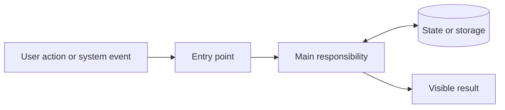

# Visual project catch-up — reusable template

Use with `$project-catchup` for any software project. Replace bracketed fields, omit irrelevant sections, and adapt to native/web/background architectures. This is a reusable document template, not an installed skill or a change to global skill settings.

## First response: visual orientation

**[Project] helps [person] accomplish [job].**

Replace the boxes with actual project components. Use 4–7 nodes, label local/remote boundaries, and omit irrelevant components.

| Remember | Concrete meaning |
|---|---|
| Main stack | [Technology → job, only the central pieces] |
| Important choice | [Choice → recorded reason, or label inference → tradeoff] |
| Relevant limitation | [Implemented versus planned, unknown or unverified] |

**Explore next:** [Two or three concrete optional topics; accept any free-form question.]

*Evidence: [date/time zone] · [branch/commit] · [comparison baseline] · [local changes] · [validation limits]. Link important claims to source.*

## Follow-up: zoom into one topic

**[Direct answer in one sentence.]**

[One small flow, worked example, or narrow comparison table.]

- **Term:** [plain definition tied to this project].
- **Behavior:** [actual implementation, with source].
- **Tradeoff:** [benefit and accepted cost; label speculation].

Ordinary follow-ups should usually fit within 200 words plus the visual. Expand when requested. No unsolicited quiz or full project recap.

## Saved reference: expandable foundation

| Field | Content |
|---|---|
| Identity | Repository, local root, purpose, intended users |
| Baseline | As-of date/time zone, branch, full commit, comparison range, local changes |
| Architecture | Small map; responsibilities and state ownership |
| Main flow | Real entry point → work → storage/integration → visible result; one failure path |
| Design choices | Current choice; recorded/inferred rationale; tradeoff |
| Verification | Tests present versus observed results; revision/date; runtime limits |
| Learning so far | Topics covered; user's self-reported understanding; terminology needing refresh |
| Open questions | Unconfirmed ownership, planned work, measurements or acceptance still needed |
| Sources | Key files/symbols, commits, official documentation |

### Learning log

| Date | Topic / project example | User-reported understanding | Next question / evidence |
|---|---|---|---|
| [date] | [topic] | [actual statement; no invented assessment] | [question or source] |

### Future snapshot

| Date | Previous → current commit | Meaningful change | Learning implication |
|---|---|---|---|
| [date] | [commits] | [verified change, separate local/planned work] | [what to revisit] |

Keep the opening short even as reference material grows. Preserve snapshots, avoid duplicating repository docs, and recheck mutable facts. Save only when requested or covered by an established maintenance instruction.
