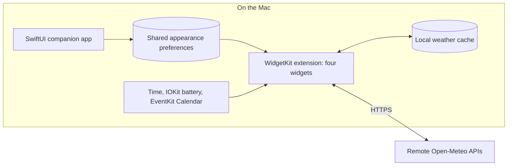

# Desktop Widgets — learning reference

Desktop Widgets is a native macOS companion app and four desktop widgets, created for personal desktop customization. Read this reference and the [visual catch-up template](Project-Catchup-Template.md) before future `$project-catchup` explanations.

The map below summarizes the **reported historical architecture** in the [preserved context snapshot](Project-Catchup-Snapshot-2026-11-02.md). Restoration checked repository identity and revision; it did not repeat the implementation review or establish running/deployed behavior.

- The companion app and widget extension run separately; applied appearance is shared through preferences.
- WidgetKit presents prepared timelines and controls actual scheduling. Weather combines remote forecasts with bounded local reuse.
- The user reports understanding the concepts already covered; refresh terminology as needed and explain the requested topic next.

## Reading route and evidence boundaries

| Reference | How to use it |
| --- | --- |
| [Preserved context — prepared November 2, 2026](Project-Catchup-Snapshot-2026-11-02.md) | Complete supplied discussion: architecture, timelines, customization, weather reliability, privacy, concepts, hypotheses, distribution options, evidence, and open work. Historical observations retain their original dates and limits. |
| [Visual project-catchup template](Project-Catchup-Template.md) | Supplied reusable layout for short orientations, focused follow-ups, learning logs, and later snapshots. Project-local reference; no global skill settings were changed. |
| [Product documentation](../README.md#documentation) | Entry point to canonical widget and design-system documentation. Prefer these and verified source for current implementation claims. |

The snapshot and template are verbatim copies of the supplied files. The snapshot's original paste/restore directions are retained as historical text. This page and the current user request define how to continue the reference; hypothetical improvements in the snapshot are discussion, not work to implement.

## Historical baseline — preserved, not re-dated

| Field | Recorded value |
| --- | --- |
| Repository | `https://github.com/joshuawyadao/MacOS-Widgets` |
| Initial review | October 19, 2026 |
| Snapshot preparation | November 2, 2026, America/Los_Angeles |
| Reviewed branch / full commit | `main` / `7d2ce82758b7c893fab1d8da05b527214fc23665` |
| Comparison window | September 19–October 19, 2026, the initial default window; the supplied report records no commits in that window and inspection of August–September history. |
| Reported local source | `/Users/joshuawyadao/Documents/Coding Projects/macOS Widgets`; retained exactly as recorded, not checked as a current source location. |
| Reported working tree | Matching clean local checkout at that review. |
| Historical CI | The supplied report records a September 3 PR #17 run at `6f5befeb4acfb862890ae41fb52bc9cde093217b`, with tests, coverage, and an unsigned Release build; no local tests were run for that discussion. This restoration did not independently recheck that run. |
| Limits | Signing/manual acceptance remained partly unverified; personal contribution and impact were unconfirmed; no performance measurements were established. Mutable distribution pricing, rules, service terms, and repository visibility remain historical claims to recheck before acting. |

## Restoration note — November 2, 2026

This is a documentation restoration, not a new full project review.

| Check | Observed during restoration |
| --- | --- |
| Workspace | `/Users/joshuawyadao/.codex/worktrees/ef9a/MacOS Widgets` |
| Repository identity | Local `origin` is `https://github.com/joshuawyadao/MacOS-Widgets.git`. Remote service state was not checked. |
| HEAD | `7d2ce82758b7c893fab1d8da05b527214fc23665`, **detached HEAD**, not a checked-out `main` branch. |
| Comparison | HEAD equals the recorded source baseline; no intervening committed source changes to explain. |
| Initial local state | Clean before restoration; the documentation changes were initially left local and unstaged, before the subsequent save request below. |
| Verification scope | Supplied file preservation, baseline metadata, documentation links/structure, and the documentation-only diff. No application tests, performance runs, new CI results, deployment checks, enrollment, or publication. |

Matching commits establish the same tracked source revision, not a new observation that every historical behavior, platform rule, test result, or installed widget still holds. Recheck the relevant files and current HEAD/local changes when answering a question about current code.

## Save follow-up — November 2, 2026

After the local restoration, the user explicitly requested a feature branch and a push of these documentation changes to GitHub. GitHub access and push permission were confirmed, and `codex/restore-project-learning-reference` was created from `7d2ce82758b7c893fab1d8da05b527214fc23665`. This supersedes the earlier local-only constraint for the documentation save. The original snapshot and template remain unchanged; no new technical lesson or application change was requested. The branch's actual commit/upstream state is Git evidence to check, not a deployment claim.

## Learning position and conversation preferences

- Start a future catch-up with a short visual overview: one sentence, a 4–7-node diagram or compact table, and at most three takeaways. Use only the context needed for the current question.
- Continue one topic at a time as the user asks, usually under 200 words plus a focused visual/example. Use concrete project behavior and refresh terminology briefly when useful.
- Do not repeat the entire beginner briefing or initiate a quiz, teach-back, or mock interview unless requested.
- Previously discussed topics include provider/model/view responsibilities, timelines versus reloads, process boundaries, shared preferences and themes, dependency injection and protocols, request coalescing, caching and stale fallback, Calendar data minimization, explicit state modeling, profiling hypotheses, and distribution options. See the snapshot for details rather than repeating them here.
- Understanding is self-reported. Exact personal contributions, ownership, AI/collaborator involvement, and measured impact remain unconfirmed. Use neutral project wording and do not invent mastery scores or performance results.

## Learning log

| Date | Topic / project example | User-reported understanding | Evidence / next question |
| --- | --- | --- | --- |
| November 2, 2026 | Restored earlier architecture and engineering discussion; project examples and terminology are in the preserved snapshot. | “I understand the concepts covered so far but may need terminology refreshers.” | Current restoration request and supplied snapshot. No new technical lesson, quiz, or mastery assessment occurred during restoration. Await the user's next topic. |

## Snapshot history

| Date | Baseline / comparison | Meaningful change | Learning implication |
| --- | --- | --- | --- |
| October 19, 2026; prepared November 2 | Reported `main` at `7d2ce82758b7c893fab1d8da05b527214fc23665`; September 19–October 19 window | [Original discussion snapshot](Project-Catchup-Snapshot-2026-11-02.md), including the historical CI and manual-verification limits | Prior foundations are available; use focused refreshers. |
| November 2, 2026 — restoration | Same full commit; local checkout is detached | Imported context/template and added local documentation entry points; no application behavior changed | Reference can be read before future explanations; this is not a fresh runtime or CI assessment. |

## Updating this reference

When the user asks to update the reference:

1. Read the existing reference and snapshots first. Record the new note's date/time zone, actual branch or detached state, full commit, local changes, and comparison baseline relevant to the discussion.
2. Append the discussion to the learning log: topic, concrete project example, linked evidence, actual user-reported understanding, and remaining question. If no understanding statement was made, say it was not assessed.
3. Add a new dated snapshot for changed facts or a substantial new discussion, and link it in the history. Preserve previous snapshots and their complete baseline metadata; use a distinct suffix if multiple snapshots share a date.
4. Separate historical observations, newly verified current code, local uncommitted work, plans/hypotheses, and unknowns. Distinguish tests present from tests observed passing, and label rationale as recorded, inferred, or unknown.
5. Link canonical source/docs instead of copying whole implementation guides. Correct old claims through a dated note linked to their snapshot; retain what the earlier evidence actually supported.
6. Keep contribution and performance statements within established evidence. Saving a discussion does not authorize implementing its ideas, profiling, publishing, enrollment, or automation. Do not update project notes silently without an update request or an established maintenance instruction.

Open topics remain those in the preserved snapshot: unconfirmed contributions/requirements, Battery read-failure versus absent-hardware modeling, measurement before optimization, manual accessibility/appearance/sleep-wake/upgrade acceptance, and possible future distribution migration. These are retained questions and proposals, not an implementation backlog for this request.

## Import provenance

- Supplied context: `/Users/joshuawyadao/Documents/Codex/2026-10-19/ca/outputs/macos-widgets-context.md`.
- Supplied template: `/Users/joshuawyadao/Documents/Codex/2026-10-19/ca/outputs/project-catchup-template.md`.
- The source folder's October 19 date does not replace the context's explicit November 2 preparation date or its October 19 initial-review baseline.
- Future explanations should use the repository copies above; access to the original personal output folder is unnecessary.
